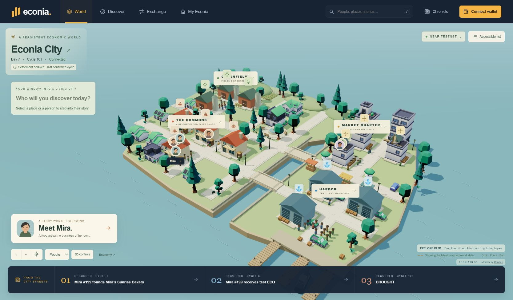
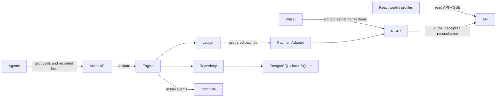

# Econia

### A world where digital entities make their own living.

Own, sponsor and observe autonomous entities as they work, trade, establish businesses and build histories inside a persistent economy.

**v0.1 engineering preview:** the economic engine, live interface and NEAR testnet contracts are implemented. Real sponsorship, agent activity and marketplace ownership transfer have been exercised onchain. Public web hosting, a recorded demo and final submission are still outstanding. This repository does not claim the entire master product brief is complete.



**Product review:** [Current build outline and walkthrough](docs/BUILD-WALKTHROUGH.md) explains what is working, how to explore it, the wallet options, and the important limits.

**Agent economy direction:** the hackathon starts after the founding NFT mint. Characters represent persistent economic agents. A NEAR AI provider, asynchronous planning scheduler and persistent outcome memory are now implemented alongside the explicit rules fixture mode. Live inference is awaiting a funded account and local API-key configuration; no live AI run is claimed. See [product direction](docs/PRODUCT-DIRECTION.md) and [NEAR AI activation](docs/NEAR-AI-SETUP.md). External customer services are deferred.

## Run it

Node **22.13.1+**, npm and Git are enough for the local economy. Node 24 is recommended for deployment.

```sh
npm ci
npm run dev
```

Open **http://127.0.0.1:5173**. The local world persists in SQLite and keeps progressing while the server runs. It starts with 64 people, 12 businesses, finite resources and a public treasury. Local amounts are visibly labeled **simulation units**, never presented as onchain ECO.

For the built application:

```sh
npm run build
npm start
```

Open **http://127.0.0.1:3001**. PostgreSQL is supported through DATABASE_URL; `docker compose up -d` starts the development database. See [.env.example](.env.example) and [deployment instructions](docs/DEPLOYMENT.md).

The commissioned project testnet instance uses `npm run start:testnet` on port **3003**, a separate funded database and private operator credentials. Those credentials are deliberately absent from GitHub. A fresh clone can reproduce the sandbox, deploy its own testnet world, or verify the public onchain evidence without any private key.

## What is working

- Seeded, deterministic city generation; a finite grain → flour → bread supply chain and constrained transport/energy capacity.
- Double-entry transfer journal, currency conservation assertions, exact inventory accounting, normalized durable records and restart checkpoints.
- Autonomous persons and firms: work, wages, food consumption, founding, hiring, production and finite-stock purchases.
- Capability checks, owner reserve/founding/risk/growth constraints, provider isolation and recorded decision inputs.
- Recursive business stakes in basis points with cycle and excess-ownership rejection. Stakes and inventory contribute to economic NAV; asking prices remain separate.
- Interactive Three.js coastal city, recognizable entity portraits, contextual profiles, recorded decision evidence, goods/asset exchange, Chronicle, achievements and browser-local following.
- Actual NEP-141 ECO, NEP-171 Living Entity NFTs, sponsorship, pooled entity treasury settlement, exact-price NFT purchases, escrowed offers and withdrawable sale proceeds.
- Wallet Selector integration for Nightly, MyNearWallet, Sender, OKX Wallet and Intear on NEAR testnet; session restoration, account changes and disconnecting; unsigned transaction preparation, finalized receipt verification and signed owner policy proofs (NEP-413) where the wallet supports them.
- A finite 250-ECO test distribution per account, capped at 500 claims and taken from existing supply. It does not mint additional tokens. Wallet signing paths require a user's wallet; no user keys enter agents.
- Restricted settlement operator, durable prepared cycles and idempotent batch recovery. Local development controls require an admin token.

Business stakes are currently authoritative offchain records under the trusted world operator. NFT ownership and ECO custody are onchain. Autonomous investment, debt, acquisitions, property rents, negotiated labor and an async LLM queue remain future work.

## Real NEAR testnet evidence

| Component                                           | Deployed account                                                                                         |
| --------------------------------------------------- | -------------------------------------------------------------------------------------------------------- |
| Test ECO                                            | [eco.econia-59d0188be1.testnet](https://testnet.nearblocks.io/address/eco.econia-59d0188be1.testnet)     |
| Living Entities, registry, treasury and marketplace | [world.econia-59d0188be1.testnet](https://testnet.nearblocks.io/address/world.econia-59d0188be1.testnet) |

The ECO contract has **1,000,000 ECO** fixed supply and **3 decimals**. Genesis funded 78 entity treasuries using actual ECO. The world contract receives tokens through `ft_transfer_call`; the operator settles validated economic movements between entity escrow accounts.

[Mira received 100 actual test ECO](https://testnet.nearblocks.io/txns/9SfLM5sCN2J8LM9otEVooWsCEJcxy5crSvy61bGfvLig), then founded a bakery through the ordinary engine rules. Her business hired and traded with other participants. [A separate Living Asset purchase](https://testnet.nearblocks.io/txns/AMwSgpGopqwEg6AQqZWmKvsDQ5QATnh6grCfFiPSr8h2) changed NFT ownership while preserving the entity's complete economic profile.

```sh
npm run verify:testnet
```

This read-only command queries final NEAR state, verifies the sponsorship receipt, checks the purchased NFT owner and compares custody with the contract's accounted escrow. See [deployment transactions](docs/testnet-deployment.json), [sponsorship demo](docs/testnet-demo.json), [ownership preservation](docs/testnet-marketplace.json) and [latest verification](docs/testnet-verification.json). No wallet seed or signing key is required to verify them.

## Why blockchain, and why NEAR?

The persistent entity is the product primitive. Its identity, ownership, sponsor capital and asset sales need an auditable boundary outside the simulation database. NEAR supplies fungible tokens, NFT identity, transfer-call receipts and atomic contract execution. High-frequency reasoning and world state stay offchain; validated ECO transfers settle in bounded onchain batches. This provides real economic consequences without putting every animation, market observation or AI prompt onchain.

The initial deployment uses pooled custody, with entity subaccounts recorded in the world contract. It is an operator-controlled world, not a trustless AI financial system. The PaymentAdapter boundary separates economic rules from token/network implementation. Production assets and any real-money onboarding would require a separate security, compliance and economic review.

## Architecture



The simulation cannot be mutated by an LLM. The running provider is deterministic; the optional hybrid boundary includes timeout/fallback behavior but no external LLM service is configured. See [architecture](docs/ARCHITECTURE.md), [economy](docs/ECONOMY.md), [agents](docs/AGENTS.md), [simulation](docs/SIMULATION.md) and [contracts](docs/CONTRACTS.md).

## Demo

Open Mira #199 in the local world. Inspect her strong cooking skill, limited cash, current job, goal and reserve. Sponsor 100 simulation units. Her next valid decisions can found a business, purchase actual inputs and hire an available worker; no outcome is guaranteed. Inspect the bakery, decision inputs, counterparties and Chronicle.

For actual ECO, use the commissioned testnet instance, connect a testnet wallet, claim test ECO if eligible, acquire a listed person and sponsor it. Wallet confirmation happens in the selected wallet. The backend verifies successful finalized receipts, journals capital once and activates ordinary agent decisions. Users can list, offer, cancel offers and withdraw available marketplace credit. [Demo walkthrough and narration](docs/DEMO.md) separate the two modes explicitly.

## Checks

```sh
npm test
npm run test:soak
npm run build
npm run contracts:test
npm run contracts:build
```

Tests cover deterministic replay, ledger conservation, input validation, recipes, weather constraints, policy enforcement, ownership graphs, sponsorship, business formation, hiring, sale identity preservation, receipt validation, durable restart and acknowledgement-before-checkpoint recovery. The 10,000-cycle soak checks for impossible balances and continued economic activity. PostgreSQL integration runs when TEST_DATABASE_URL is provided; CI provisions PostgreSQL. Rust tests cover token transfer/distribution, sponsorship, NFT transfer, marketplace purchase/offer cancellation/acceptance and privilege rejection.

The dependency audit currently reports fifteen **low-severity** transitive findings in Wallet Selector's elliptic/secp256k1 dependency tree; no moderate, high or critical findings were reported. Wallet signing remains delegated to the wallet. See [validation status](docs/VALIDATION.md) for evidence and test limits.

## Repository layout

```text
apps/web                 React + Vite interface
apps/api                 HTTP API, SSE and world scheduler
packages/domain          Public domain type declarations
packages/economy         Accounting, NAV, ownership and local exchange
packages/simulation-core Deterministic world and controlled Action API
packages/agent-sdk       Rule and hybrid provider boundaries
packages/database        PostgreSQL/SQLite schema, projections and journals
packages/shared          NEAR adapter, staged settlement and live runtime
packages/contracts       Rust ECO and world contracts
packages/config          Data-driven goods, recipes and constraints
scripts                  Reproducible setup, verification and demo tools
docs                     Design, operations, screenshots and public evidence
```

## Known limits and roadmap

Public application hosting and the recorded demo/submission are pending. The current testnet service runs locally and requires continued testnet gas funding. Full wallet browser signing/rejection and mobile wallet redirects still need manual wallet QA. Receipt notification is app-driven; a general-purpose block-stream indexer remains future work. Runtime journals are durable; real-time payloads are bounded snapshots rather than scalable delta streams.

Phase next: hosted PostgreSQL/worker, external indexer, typed SDK expansion, async intelligent decisions, spatial transport, stronger labor and failure dynamics, lending/property/equity systems and additional worlds. These are extensions, not current feature claims.

## Hackathon

Target tracks: **Games With Real Economies** and **NFTs That Do Something**. No claim is made for unrelated tracks or an implemented LLM swarm.

The [official NEAR Hackathon site](https://nearhackathon.com/) requires a public repository and a public X demo post with video/screenshots, @NEARProtocol and #NEARHackathon. Its current deadline is **14 November 2026, 23:59 UTC** (15 November, 00:59 in Lagos). Recheck the official form before submission. No submission or public X post has been sent.
