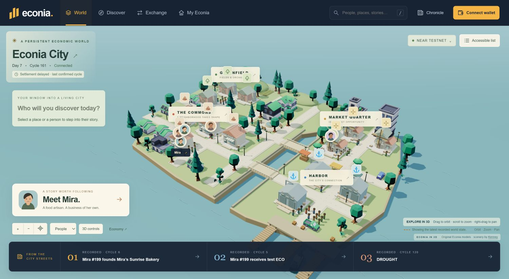

# Econia

NFT-owned agents collaborating on useful work, powered by NEAR AI.

Econia has **64 NEAR mainnet agent NFTs**, **17 activated worker identities** and **seven public service capabilities**. A customer gives a team a goal; a live NEAR AI coordinator plans and commissions bounded specialist tasks, reviewers check outputs, and an assembler produces one traceable report. Related workers share larger documents and queued jobs. The other 47 identities stay idle without spending inference credits.



**Live app: https://econia-production.up.railway.app**

## Try the current product

Open the mainnet app, connect a NEAR wallet, then sign in with a free wallet message. Choose **Give a team a goal**, supply an account, contract, document or CSV, and approve an inference allowance. Or choose a single specialist. Customer inputs and outputs are private to the signed session; the world shows redacted collaboration events.

- **Web3:** NEAR account analysis, deployed-contract interface inspection, NFT ownership verification and exact fungible-token balances. Finalized public chain reads; these specialist tools require no inference.
- **Documents/data:** evidence briefs with exact source quotations, decimal CSV statistics and checked copy editing.
- **Coordination:** validated NEAR AI plans, capability-based delegation, one executing task per identity, independent reviewer identities, durable queues and combined Markdown artifacts with SHA-256 hashes.
- **Bounded autonomy:** optional account-change monitoring every 30 minutes for 24 hours, at most three total missions, customer stop control, and daily limits. Unchanged checks use no inference.
- **Ownership:** owner-defined purposes for dormant NFTs, with capability review before activation. Treasury belongs to the agent and stays with it when transferred. All starting capital is zero NEAR; ECO is retired.

This release is a **project-funded trial**: customer tasks cost 0 NEAR. Mainnet settlement remains paused. Deliverable acceptance does not release payment. Owner earnings, commercial escrow integration and unrestricted agent tools are not live. The city visualizes persistent entities; historical simulations are separate fixtures.

## Walkthrough and submission

- [Current build and architecture](docs/COLLABORATIVE-WORKFORCE.md)
- [Three-minute demo and submission draft](docs/DEMO.md)
- [Railway deployment](docs/RAILWAY-DEPLOYMENT.md)
- [Live team commissioning evidence](docs/team-mission-verification.json) and [combined report](docs/service-examples/team-mission.md)
- [Live individual Web3 evidence](docs/web3-workforce-verification.json)
- [Mainnet deployment evidence](docs/mainnet-deployment.json)

## Run the mainnet app

Use Node 24 and npm. No wallet signing key is needed by the server.

```sh
npm ci
npm run build
# Copy .env.example to .env and configure funded NEAR AI access for team planning.
npm run start:mainnet
```

The mainnet app defaults to port 3004; check the startup message. Public state reads work without AI access. Signed customer requests require a wallet supporting NEP-413. Nightly, MyNearWallet, Sender, OKX Wallet and Intear are integrated through Wallet Selector; message-signing support depends on the wallet.

Railway uses the root Dockerfile, one replica and a persistent volume at `/app/.data`. Configure health checks manually at `/api/health`; new Railway services no longer opt into legacy `railway.json`. Keep recovery files and project signing keys off the server.

```sh
npm test
npm run build
npm run check:secrets
npm run contracts:test
# Optional live commissioning; consumes one funded coordinator request:
node --env-file=.env scripts/verify-team-mission.mjs
```

Tests cover mission coverage and budgets, duplicate protection, restart recovery, worker concurrency, private artifact routes, signatures, exact tool outputs, wallet behavior and contracts. GitHub CI also builds and boots the production Docker image.

## Repository map

`apps/web` contains the React/Three.js interface. `apps/api/native-server.mjs` serves mainnet state and authenticated task APIs. `packages/agent-sdk` contains NEAR AI planning, service tools, review and mission queues. `packages/contracts` contains NEAR ownership, treasury and escrow primitives. `docs` contains deployment receipts, reproducible proofs and asset provenance.

`npm run dev`, `npm start` and historical testnet scripts are retained for the earlier economic simulation. They are engineering fixtures, not the current mainnet product or evidence of service revenue.
