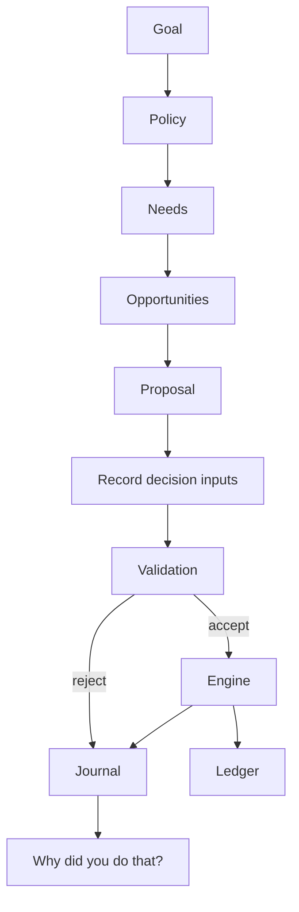

# Agent controllers

The AgentProvider boundary proposes actions; only the engine executes them. `AGENT_MODE=rules` selects reproducible development fixtures. `AGENT_MODE=near-ai` selects the asynchronous NEAR AI scheduler in `packages/agent-sdk/scheduler.mjs`. It reserves a daily request allowance and checkpoints requests before inference, rotates planning slots across active entities, persists bounded outcome memory and supplies synchronous prepared proposals to the engine. Testnet cycles use the same prepared-settlement recovery path. A live model trial returned an accepted hiring proposal in an isolated sandbox; automated tests use an explicitly injected provider. Actual AI testnet settlement remains unverified.

NearAIProvider calls the official server-side gateway, validates response shapes and discards internal reasoning traces. No model receives wallet keys. Ready proposals retain model/request/context evidence. The engine rechecks capabilities, reserves and availability at execution; stale saved context is invalidated on recovery. Interrupted inference is not automatically repeated because it may already have been billed. Failed or unscheduled work becomes an explicitly sourced scheduler WAIT, never a hidden rule fallback.

Missing inference configuration pauses AI cycles. The old HybridAgentProvider remains an unused compatibility helper; the active AI scheduler does not use it. See [activation and limits](NEAR-AI-SETUP.md). Negotiation and external services are not added by exposing the existing seven economic actions to a model.

Facts are captured before execution: cycle, available cash, reserve, risk policy, goal, quoted prices, and any founding margin estimate. Explanations are not generated after outcomes. The UI exposes the recorded facts and accepted/rejected result.

Rules prioritize operating needs, input replenishment, staffing and production. Persons consider starting a business if skill, ambition, capital, reserve and risk-adjusted quoted margins permit. Growth policy sets startup capitalization; risk policy sets a margin hurdle; owner permission can prohibit founding. Other decisions buy food, consume purchased inventory or work. Public work is a funded fallback when no private contract exists.

The validation layer checks capabilities, action shape, quantity bounds, reserve requirements, owner restrictions, equipment, skills and labor availability. A provider cannot write the economic database. Third-party providers receive cloned state; the trusted deterministic rules receive read context. Invalid actions are recorded as rejected; provider exceptions activate fallback.

Capabilities allow PERSON, BUSINESS, PROPERTY, MACHINE and ORGANIZATION identities. PERSON and BUSINESS have active strategies in v0.1. Property rent, machine autonomy, investing, borrowing and negotiation tools are future extensions, not implemented merely because a capability name exists.
