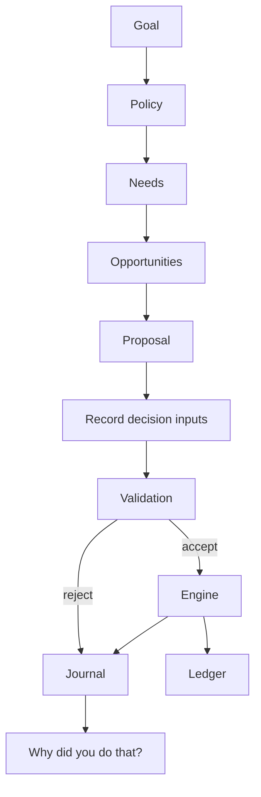

# Agent controllers

The AgentProvider boundary returns `{action, reason, facts}`. RuleBasedAgentProvider implements the running economy. HybridAgentProvider supplies an optional asynchronous provider boundary with a 1.5-second timeout and deterministic fallback; no external LLM is configured in the running worker. The synchronous tick loop deliberately rejects async results and uses rules. An async decision queue must be connected before enabling an LLM provider in production.

Facts are captured before execution: cycle, available cash, reserve, risk policy, goal, quoted prices, and any founding margin estimate. Explanations are not generated after outcomes. The UI exposes the recorded facts and accepted/rejected result.

Rules prioritize operating needs, input replenishment, staffing and production. Persons consider starting a business if skill, ambition, capital, reserve and risk-adjusted quoted margins permit. Growth policy sets startup capitalization; risk policy sets a margin hurdle; owner permission can prohibit founding. Other decisions buy food, consume purchased inventory or work. Public work is a funded fallback when no private contract exists.

The validation layer checks capabilities, action shape, quantity bounds, reserve requirements, owner restrictions, equipment, skills and labor availability. A provider cannot write the economic database. Third-party providers receive cloned state; the trusted deterministic rules receive read context. Invalid actions are recorded as rejected; provider exceptions activate fallback.

Capabilities allow PERSON, BUSINESS, PROPERTY, MACHINE and ORGANIZATION identities. PERSON and BUSINESS have active strategies in v0.1. Property rent, machine autonomy, investing, borrowing and negotiation tools are future extensions, not implemented merely because a capability name exists.
