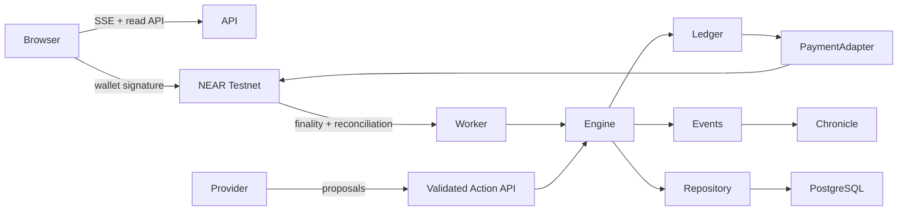
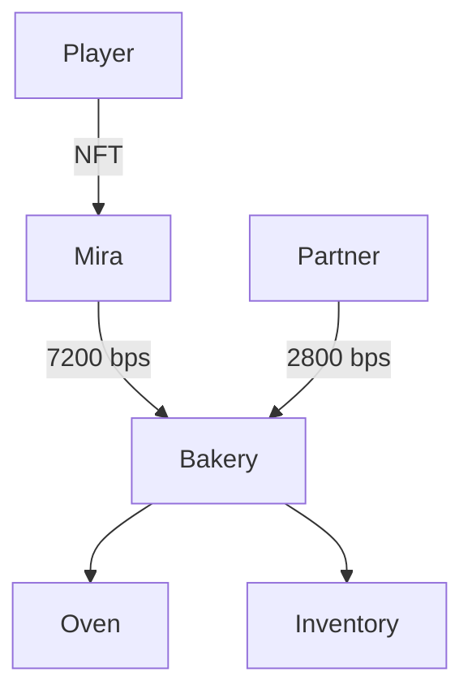

# Econia v0.1 architecture

Milestones: A domain/ledger and persistence; B finite supply chain/labor; C bounded agents; D NEAR contracts and settlement; E live explorer; F constraints and Chronicle; G tests/deployment evidence. Implement in dependency order.

## ADR 001: authoritative economic engine

The engine is a deterministic state machine. Providers propose actions; only the Action API executes them. Money uses integer thousandths in the simulation and 3 decimal places in the test ECO contract. No floating point balances. Each movement has an equal debit and credit. A cycle is atomic with its durable checkpoint and event stream. PostgreSQL stores normalized projections plus replay checkpoints; local SQLite is an explicitly local development utility.

## ADR 002: custody boundary

Test ECO uses NEP-141/145/148. The world contract receives actual ECO through ft_transfer_call, credits named entity treasuries and records sponsorship. This pooled escrow backs the entity subledger; it is operator-controlled, not trustless AI custody. High-frequency economic movements are batched at the settlement boundary. The token and world/NFT/market modules are separate contracts. No human wallet key enters an agent. Sandbox amounts are simulation units, never represented as real ECO. Testnet mode must fail closed until deployed, funded, reconciled contracts and an operator signer exist.

## ADR 003: persistent identity

NFT token ID equals immutable entity ID. Ownership transfer changes the owner, never economic state. Business stakes use basis points with cycle checks. Future entity types register capabilities and recipes rather than type-specific engine branches.

## Dependencies

Node 22.13+ (SQLite local persistence), React/Vite (web), pg (PostgreSQL), NEAR Wallet Selector (wallet), near-api-js 7.2.0 (operator). Rust near-sdk and near-contract-standards 5.24.1 support the installed Rust 1.93.1 compiler; newer SDK releases were researched and require a compiler update. Locked dependencies record tested versions.

Release blockers and deployment evidence are recorded in DEPLOYMENT.md. A local engine is not a deployed testnet product.
