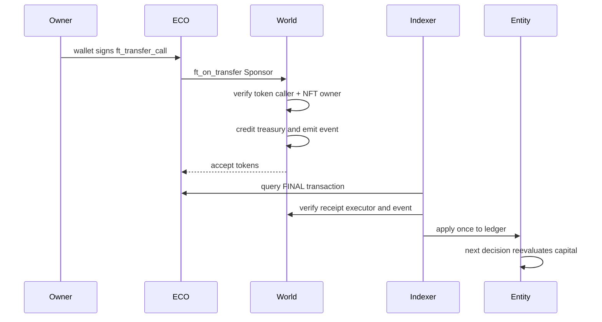

# NEAR contracts and settlement interfaces

The latest official NEAR SDK was researched before implementation. This checkout pins the compatible stable near-sdk / near-contract-standards 5.24.1 and near-sys 0.2.7; their declared minimum Rust is 1.86. The installed compiler is 1.93.1. Newer 5.30 releases require a newer compiler. Rust dependencies are locked. JavaScript uses near-api-js 7.2.0 to support the installed Node version.

## ECO

NEP-141 transfer/transfer_call, NEP-145 storage, NEP-148 metadata, 3 decimals. A fixed supply is minted at initialization to the project owner. The public test distribution transfers 250 ECO from that existing supply once per account, at most 500 claims; it charges added storage and refunds surplus attached NEAR. There is no public unlimited mint, production token or fiat acquisition. Account storage must be registered before receipt.

## Living world

The world contract composes NFT, entity registry, pooled ECO escrow and marketplace modules in one atomic boundary. Keeping NFT sale and escrow credit together avoids asynchronous NFT/payment half-settlement. The fungible token stays a separate contract. NFT core (NEP-171), metadata (NEP-177), enumeration (NEP-181) and transfer-call resolution delegate to the standards library. Approval extensions are intentionally omitted. Token ID is the entity ID; registry state persists after transfer.

`mint_entity(entity_id, receiver_id, entity_type, name, provenance)` is owner-only, payable and storage-metered. `get_entity` returns immutable linkage and economic treasury. `ft_on_transfer` accepts only the configured ECO contract, registered senders and bounded messages. Sponsor messages require current NFT ownership; amounts are recorded in treasury/sponsored totals and NEP-297-style events. Genesis funding is restricted to the project owner.

`settle_batch(batch_id, state_hash, movements)` accepts only the operator, preflights all transfers, rejects overdrafts, limits batches to 50 movements and enforces a strict monotonically increasing batch ID. Same-ID/same-hash retries do nothing. The operator is trusted to enforce world rules, not a trustless consensus mechanism. It cannot target arbitrary human wallets through the settlement API.

`list_asset`, `cancel_listing`, `get_listing`; exact-price purchase through ECO `ft_transfer_call` with `{kind:"Buy",entity_id}`. Transfer of the NFT and sale proceeds credit are atomic within the receiver receipt. An NFT transfer invalidates its listing. Offers use `{kind:"Offer",entity_id}` and escrow the actual ECO. Sellers can `accept_offer`; bidders can `cancel_offer` to release credit. Up to eight open offers per registered wallet bounds storage. Other offers remain cancellable after an asset changes owner.

Seller proceeds are a withdrawable ECO escrow credit. `withdraw(amount)` reduces credit before transfer, and a private callback restores it if the token transfer fails. Entity sponsorship is nonrefundable; it is distinct from seller proceeds. There is no guaranteed return or APY.

The JavaScript PaymentAdapter verifies final execution, signer, token receiver, successful world receipt executor and matching sponsorship event. Reconciliation compares entity projections to custody accounts and total ECO escrow. It rejects missing contracts or signer configuration. Contract unit tests are not a substitute for deployed cross-contract integration and security review.
