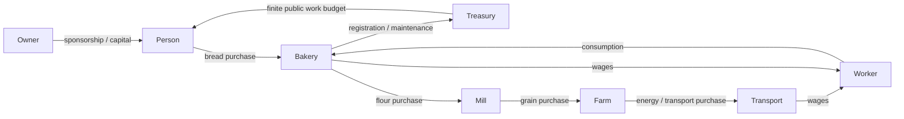

# The economic model

Money uses integer milli-units. Sandbox currency is `SIM`; it is not ECO. The NEP-141 test ECO contract also uses three decimal places, so settlement never requires floating point conversions. Genesis has a finite budget. The engine asserts conservation after every cycle and every API mutation. Journal entries record source, destination, amount, asset, cycle, reason and idempotency key.

## Sources, circulation, costs

The public treasury begins with 500,000 units. People have seeded starting capital, 12 firms have operating capital, and the explicitly local demo account has 1,000 units. Nothing mints currency in a tick. Public infrastructure shifts transfer 0.9 units from the treasury; private contracts transfer 1.5 units from employers. Public spending is finite and will eventually exhaust without fiscal changes. That is an economic constraint, not an infinite faucet.

Consumers buy and consume bread. Private wages are paid for completed work shifts, not merely for being employed; agents alternate work and consumption needs. Contracted staff increase a firm's configured capacity, an aggregate labor abstraction. Farms use energy to grow grain; mills turn grain into flour; bakeries turn flour into bread. Transport businesses produce finite renewable service/energy capacity, constrained by equipment, staffing, inventory limits and maintenance. Farming represents renewable harvests, not extraction from an infinite inventory. The transport/energy abstraction is deliberately combined in v0.1; spatial shipping and separate power plants remain extensions.

Recipes live in packages/config/catalog.json. Production consumes every input, records each output, checks equipment and skill thresholds, and caps batch count based on employment. An inventory ceiling prevents producing unlimited unsold goods. Lower harvest output consumes the same input capacity. Consumption and production counters permit exact stock reconciliation.

Registration/equipment costs 10 units, paid to the public treasury; the business carries the equipment at a 10-unit cost basis. Maintenance is 0.25 units per ten cycles. These are service charges with economic purposes, not token burns. Capital transfers and sponsorship are excluded from operating revenue/expenses.

## Market mechanism

Buy actions match finite, actual producer inventories in deterministic entity-ID order at a published city quote. No nonexistent seller can fill an order. Quotes move smoothly toward a bounded stock-sensitive value (0.5–3 times the catalog baseline). The mechanism is an inventory-sensitive dealer market, not a bid/ask order book or a competitive price-discovery claim. Location labels are present; transport capacity constrains inputs globally, not route by route.

## Valuation and performance

Economic NAV = cash + marked inventory + cost-basis equipment + recursive proportional business NAV − debt. Stakes use integer basis points; circular ownership and aggregate stakes above 100% are rejected. Initial holdings are included in the genesis NAV baseline. Created wealth = NAV − initial capital − sponsorship. New businesses record capitalization as their baseline. These are economic estimates, never promised returns. NFT asking price is a separate market value.

Revenue includes actual operating receipts. Capital efficiency = created wealth / sponsored capital, or unavailable when unsponsored. Sponsor dependence = sponsored capital / (sponsored capital + operating receipts). Public wages are receipts, not self-created money. Business unrealized inventory gains may increase NAV without increasing cash; the UI separates those values.

## Tests and limitations

The soak script checks 10,000 cycles, finite balances and exact currency conservation. Unit tests reconcile initial stock + outputs − inputs/consumption against actual inventory after 1,000 cycles. A functioning long run is evidence against accounting bugs, not proof of a realistic equilibrium. No loans, dividends, firm acquisitions, route planning or negotiated wage changes are claimed. Bankruptcy/status handling and richer capital allocation need further economic design.
