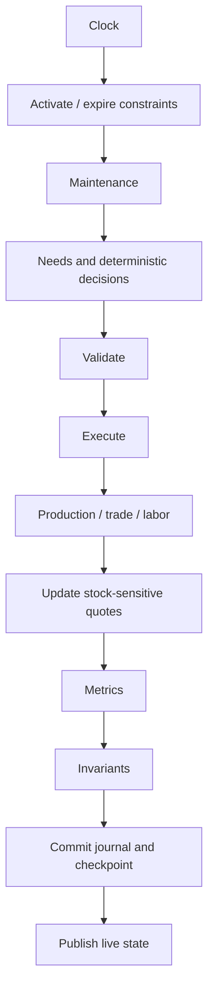

# Simulation and persistence

The world uses an abstract integer clock, not real-world seconds. A reproducible hash-based PRNG combines seed/cycle/event context. The initial population defaults to 64 persons, 12 firms and a treasury; population bounds are 4–1000. All money and goods are finite. No LLM request is needed for normal progression.

The local API owns a single world worker. It serializes all mutations with a process mutex; PostgreSQL uses an advisory lock and SQLite uses a PID lock so two workers cannot own the same world. A failed save restores the previous state. PostgreSQL is the shared deployment path; Node SQLite is a reproducible local development utility. Node's SQLite support is experimental on the installed Node 22 runtime.

The schema provides entities, inventory, immutable ledger movements, events, decisions, jobs, ownership, sponsorships, chain receipts and settlement batches. The checkpoint is a hashed restart cache in addition to normalized projections and journals. JSON holds flexible traits/context, not the sole economic database. Retained in-memory windows are bounded; persisted journal rows remain. Entity history endpoints query the durable journal. SSE uses one live connection with reconnect and heartbeat, rather than aggressive polling.

Drought, transport disruption, bumper harvest, demand surge and energy shortage alter constraints for bounded periods. Their headlines derive from actual events. Auto-events occur every 60 cycles with seeded selection. No event says that Mira must succeed.

Development routes accept an admin bearer token printed locally at startup (or ADMIN_TOKEN from the environment). They pause/resume, change cadence, advance bounded batches and trigger known constraints. The server binds to loopback by default; the local demo is not a wallet-authenticated public service. Public hosting requires the commissioning and security work described in DEPLOYMENT.md.

Partitioning by world, replacing snapshots with delta events, batching relational projections and running an async provider queue are compatible extensions. Current JavaScript rules run for eligible people/firms each cycle; no claim is made that LLM inference is already scheduled across thousands of entities.
